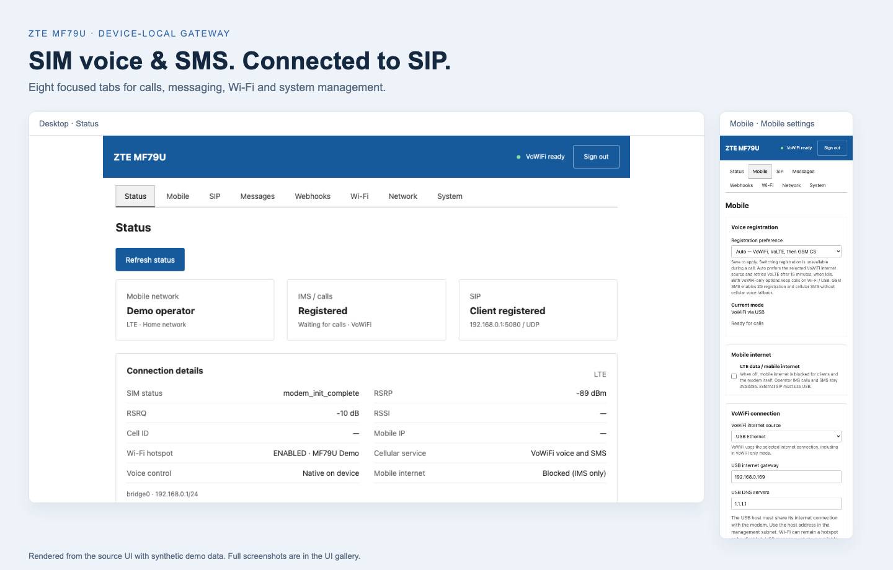
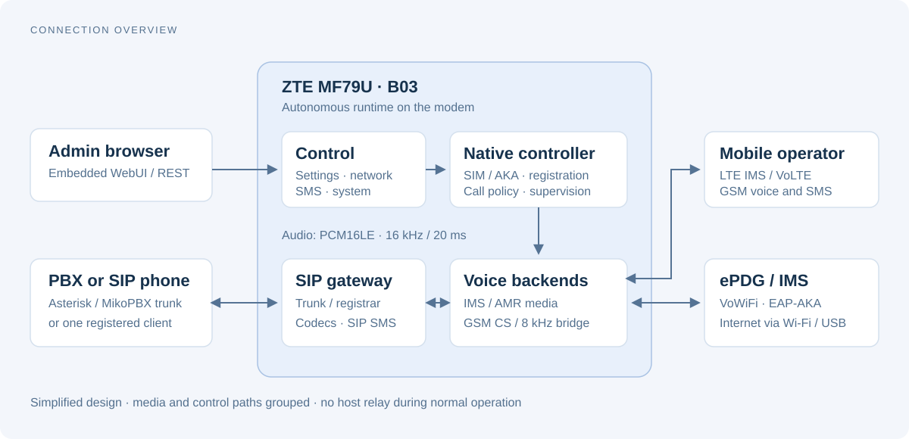
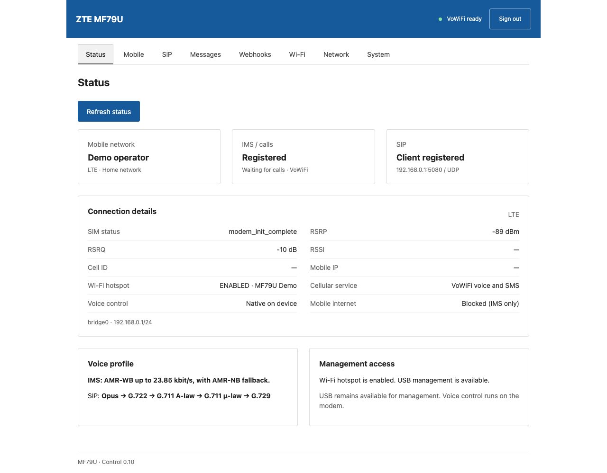
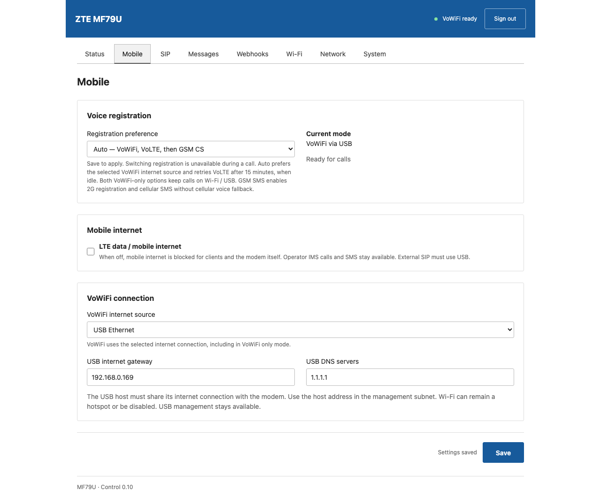
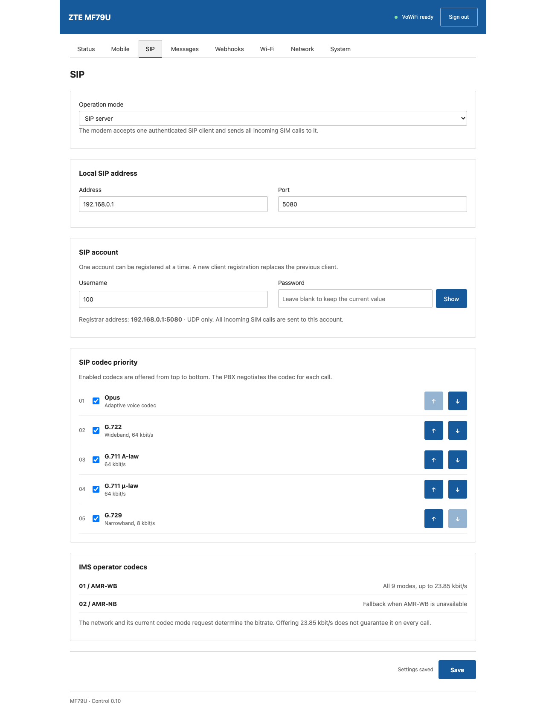
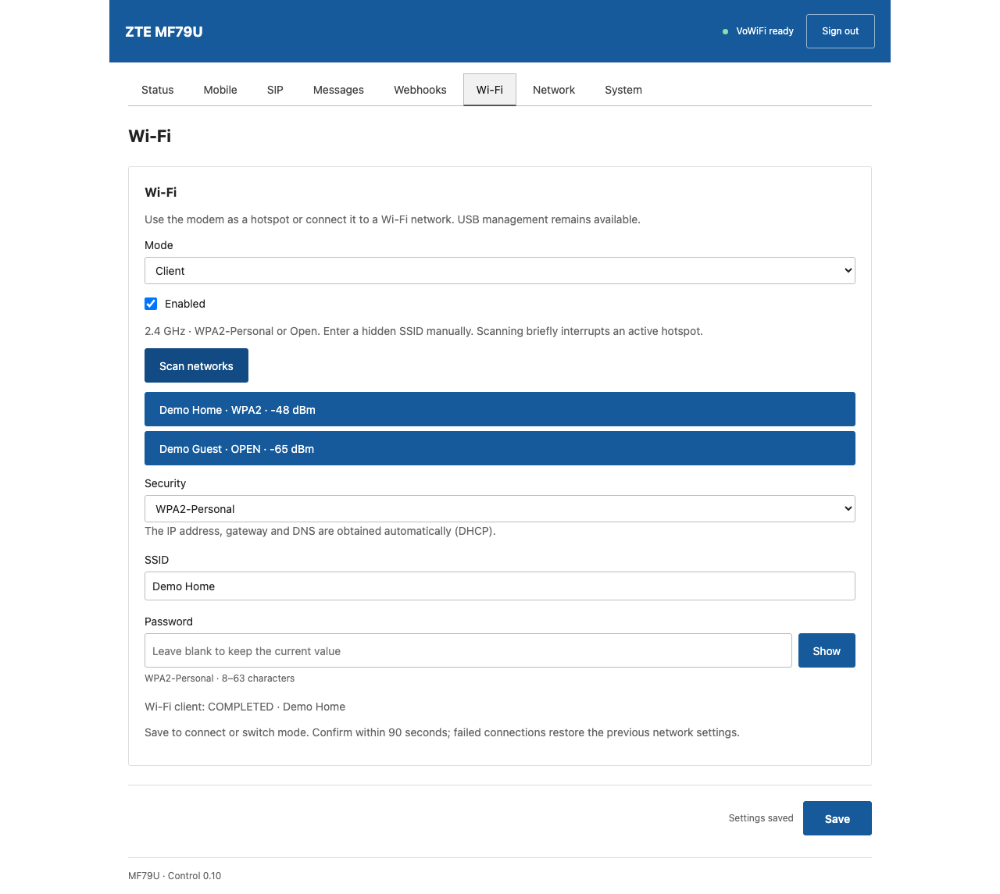

# MF79U SIP Gateway

**Turn a ZTE MF79U into a device-local gateway for SIM calls and SMS.**
Connect an Asterisk/MikoPBX trunk or a SIP phone, manage everything from the
embedded WebUI, and run the voice stack on the modem itself.

[](https://github.com/kerabann/mf79u-gsm-gateway/actions/workflows/firmware.yml)


[UI gallery](docs/UI.md) · [Architecture](docs/ARCHITECTURE.md) ·
[Build](docs/BUILD.md) · [Installation](docs/INSTALL.md) ·
[Current status](docs/STATUS.md) · [Documentation](docs/INDEX.md)



## What it does

| Area | Capabilities |
| --- | --- |
| **SIM voice** | VoLTE/IMS and GSM circuit-switched calls; AUTO selection and fallback; VoWiFi through a SIM-authenticated ePDG tunnel over Wi-Fi Client or USB internet. |
| **SIP** | External PBX trunk or built-in single-client registrar; Disabled mode; trunk UDP/TCP/TLS; configurable Opus, G.722, G.711 A-law/µ-law and G.729; caller ID and privacy separate from SIP authentication. |
| **SMS** | Inbox, Unicode sending and message management; authenticated REST API and SIP MESSAGE; private IMS inbox for VoWiFi; multipart receive assembly; optional Telegram forwarding and confirmed-delivery deletion. |
| **Networking** | Wi-Fi Hotspot/Client, scan or manual/hidden SSID, WPA2-Personal/Open and Client DHCP; shared USB/hotspot LAN and DHCP settings; ordinary LTE data blocking while retaining operator IMS. |
| **Administration** | Eight responsive English tabs, scoped Save actions, network confirmation/rollback, status LEDs, separate SSH access, system information and sanitized logs. |
| **Deployment** | One Makefile for builds, isolated tests, packaging, compatibility checks, installation and recovery; checksum-bound B03 profiles; autonomous startup and supervision. |

The operator media path supports all nine AMR-WB modes up to 23.85 kbit/s,
with AMR-NB fallback. SIP codecs are configured independently. External audio
stays **mono PCM16LE, 16 kHz, 320 samples / 20 ms**; GSM hardware audio uses
an 8 kHz bridge. Negotiated codec/rate depends on the actual network and call.

### Choose how to connect



Use **SIP trunk** for Asterisk/MikoPBX, or **SIP server** to register one phone
directly with the modem. The local registrar accepts one account and one UDP
binding. **Disabled** stops voice/SIP while preserving SMS and administration.

| Voice preference | Voice path | SMS policy |
| --- | --- | --- |
| **Auto** | Prefers the selected VoWiFi source; supports VoLTE and GSM CS recovery. | Cellular B03 SMS. |
| **VoLTE only** | Operator IMS over LTE. | Cellular B03 SMS. |
| **GSM CS only** | GSM 2G circuit-switched voice. | Cellular B03 SMS. |
| **VoWiFi only** | IMS over Wi-Fi/USB; cellular voice fallback prohibited. | IMS SMS over the same tunnel; no cellular fallback or automatic retry. |
| **VoWiFi only + GSM SMS** | IMS over Wi-Fi/USB; cellular voice fallback prohibited. | Explicit GSM 2G registration for SMS, with CS voice disabled. |

### Verification status

This is an experimental firmware project for the **exact supported MF79U B03
kernel/CP ABI**. Device receipts confirm CS↔SIP/PBX tone/echo and clearing,
AUTO fallback, a user-confirmed incoming VoLTE conversation, and an authorized
IMS SMS send/receive. The latest VoWiFi correction restored outgoing ringing;
answered audio on that revision and intermittent cold-boot registration delays
still need work. New delayed multipart reception after the latest fix remains
fixture-tested; fresh Wi-Fi Client DHCP, trunk TCP/TLS and the full codec/call
matrix are also incomplete. See [current status](docs/STATUS.md) and the
[feature/evidence matrix](docs/FEATURES.md) for precise boundaries.

Other modem variants, UMTS and GSM wideband are unverified. The maintained
delivery is a **userdata overlay with checked startup patches**. Full rootfs/SD
images are historical; factory-profile-preserving reset is not implemented.

## WebUI tour

Screenshots use the actual source UI with synthetic demo data. They do not
represent a fresh hardware test. The [full gallery](docs/UI.md) covers sign-in,
all eight tabs, SIP trunk/server and Wi-Fi Hotspot/Client at desktop/mobile sizes.

| Status | Mobile |
| --- | --- |
|  |  |
| **SIP server** | **Wi-Fi Client** |
|  |  |

## Build a checked package

Prerequisites: Docker with a running daemon, Make, Python 3.12+, Node 24 and Go.
The Makefile selects **Go 1.25.12** for the B03 memory limit. Docker Desktop
supports local macOS builds; GitHub Actions uses Ubuntu. Locked upstream archives
and container packages require internet access.

```sh
git clone https://github.com/kerabann/mf79u-gsm-gateway.git
cd mf79u-gsm-gateway
make help
make ci
```

`make ci` builds all components, runs isolated tests, creates the complete
overlay, checks the package and audits the publication file set. It needs no
modem, SIM credentials or proprietary firmware dump. Build-only B03 ABI shims
are excluded from the package; the genuine runtime libraries stay on the modem.

| Output | Purpose |
| --- | --- |
| `dist/mf79u-gateway.tar.gz` | Complete allowlisted overlay and on-device patch recipes. |
| `dist/manifest.json` | Component inventory, sizes and checksums. |
| `dist/SHA256SUMS` | Package integrity checks. |

[GitHub Actions](https://github.com/kerabann/mf79u-gsm-gateway/actions/workflows/firmware.yml)
runs the same workflow and retains build/check artifacts. It does not access a
modem, install firmware or place calls/SMS. Detailed prerequisites, optional
private historical inputs and individual component builds are in [BUILD](docs/BUILD.md).

## Install on a supported modem

Read [installation and recovery](docs/INSTALL.md) first. Have ADB access and a
verified B03 recovery route. Replace the sample serial and host IP with your
device serial and the USB-reachable computer address.

```sh
make device-status SERIAL=YOUR_ADB_SERIAL
make install-plan SERIAL=YOUR_ADB_SERIAL HOST_IP=192.168.0.169
# After reviewing compatibility, idle state, backups and recovery:
make install SERIAL=YOUR_ADB_SERIAL HOST_IP=192.168.0.169
make verify-device SERIAL=YOUR_ADB_SERIAL
```

The installer checks the exact ABI, original vendor files, ownership, idle state,
checksums and space before replacement. It preserves existing settings and data,
backs up replaced files privately, and derives private IMS from the verified
device original. A changed loaded CS driver/startup policy requires an explicitly
selected `REBOOT=1`; see the install guide. Installing does not submit a test
call/SMS or write IMEI. Stock factory reset may erase the userdata installation.

## Find your way around

```text
firmware/mf79u/       Device code, embedded WebUI, runtime tools and topic history
  control/           Go HTTP/REST service and HTML/CSS/JavaScript assets
  src/               Native controller, SIP, IMS, CS audio and policy fixtures
scripts/             Repository build, package, audit and deployment workflow
profiles/b03/        Public checksum-bound ABI and installation profiles
docs/                Current guides, UI gallery, diagrams and evidence index
outputs/mikopbx/     PBX integration notes and retained helper sources
.github/workflows/   Isolated firmware CI
```

Start with the [documentation index](docs/INDEX.md). For development, read
[CONTRIBUTING](CONTRIBUTING.md), [testing](docs/TESTING.md) and
[AGENTS.md](AGENTS.md). Historical experiments remain available without
replacing current production entry points. Secrets, live settings, messages,
recordings, vendor dumps and backups stay outside Git.

## Licensing

Project licensing has not yet been selected by the owner; public source
availability does not imply a new license grant. Third-party components retain
their own licenses. Read [THIRD-PARTY](docs/THIRD-PARTY.md) before distributing
binaries.
