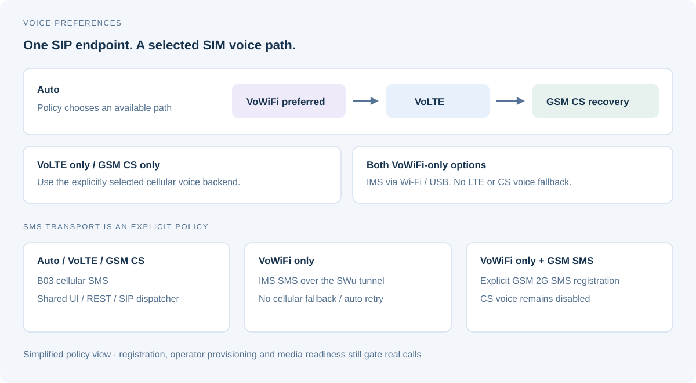
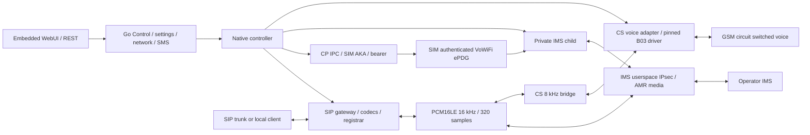

# Architecture

The host is needed for builds and installation. The installed gateway runs on
the modem and owns its CP/IMS children; normal operation has no Mac relay.

## Connection overview

The gateway presents two SIP arrangements: an external PBX trunk or one
registered client. Both use the same on-device voice backends and fixed PCM
contract. The illustration groups control and media connections; it is not a
packet trace or an observed operator network map.

## Voice and SMS policy

AUTO prefers the selected VoWiFi source and can recover through supported
cellular paths. VOWIFI and VOWIFI_SMS both prohibit cellular voice fallback.
VOWIFI uses IMS SMS without transport failover; VOWIFI_SMS explicitly enables
GSM registration for SMS with CS voice disabled. Current readiness and physical
verification limits are tracked in [STATUS](STATUS.md).

## Runtime components

## Source ownership

| Component | Source |
| --- | --- |
| CP protocol/PDP/AKA and controller | `firmware/mf79u/src/cp-ipc.c`, `cp-pdp.c`, `native-gateway.c` |
| Operator IMS SIP/ESP/AMR | `ims-userspace-ipsec.c`, `ims-software-media.c`, `vendor-codecs.c`, `amr-rate-policy.c` |
| LAN SIP/codecs/privacy/SMS/registrar | `modem-sip-gateway.c`, `sip-registrar.h`, `sip-sms.h`, `caller-id.c` |
| CS call lifecycle/kernel/audio | `cs-voice-driver.c`, `cs-driver-runtime.inc`, `cs-voice-adapter.c`, `cs-pcm-bridge.c` |
| ePDG/EAP-AKA/packet device | `vowifi-sim-plugin.c`, `vowifi-prepare.c`, `vowifi-packet-device.c`, `vowifi-runtime.h` |
| UI/REST/settings/network/SMS/System | `firmware/mf79u/control/`, embedded `control/web/` |
| LED | `net-led.c`, `net-led-policy.c` |
| Supervisors | `start-control-userdata.sh`, `start-native.sh`, `start-vowifi.sh` |
| Full package/installer | `scripts/package.py`, `scripts/device.py` |
| Portable B03 build ABI | `profiles/b03/link-abi.json`, `kernel-abi.json`, accepted voice parameters |

## Contracts

External PCM remains mono signed PCM16LE 16 kHz/320 samples/20 ms. CS hardware
8 kHz is resampled only at its bridge. AMR-WB modes 0–8 reach 23.85 kbit/s;
AMR-NB modes 0–7 are the fallback. SIP codec preferences remain configurable.
Operator policy/negotiation and hardware/network measurements must not be
confused with configured preferences.

Ordinary LTE data policy blocks IPv4/IPv6 OUTPUT/FORWARD while preserving local
operator IMS bearer `wan5`. USB and Wi-Fi Client can supply internet for ePDG.
VOWIFI mode prohibits cellular voice/SMS submission fallback; AUTO can recover
between supported paths. SIM credentials remain on the SIM and device memory.

The kernel module's fixed CP ABI is exact-B03 and ownership-guarded. It remains
pinned when suspended because B03 does not provide a fetched-callback lifetime
barrier. Process/control ownership and idle checks precede every install.
