# WebUI gallery

Captured 2026-10-12 from the repository's HTML/CSS/JavaScript in Chromium.
These are real browser renders with **synthetic demo data**, not screenshots
of a connected modem or evidence of network/call readiness. Passwords are blank,
device identity is omitted, and the sample SMS contains invented text.

The overview is a labeled composition of two cropped screenshots. Every image
below is a full-page render. Open an image to inspect its original resolution.


| Tab | What you can manage |
| --- | --- |
| Status | Mobile/IMS/SIP state, signal metrics, interfaces, voice profile and access. |
| Mobile | Voice policy, LTE data blocking, VoWiFi source and USB gateway/DNS. |
| SIP | Disabled, PBX trunk or single-client server, codec order and connection settings. |
| Messages | Modem/SIM inbox, compose, read/delete and inline REST API documentation. |
| Webhooks | Telegram incoming SMS delivery, egress interface and delete-after-confirmation. |
| Wi-Fi | Hotspot or Client, SSID/password, scan/manual selection, security and status. |
| Network | Shared USB/hotspot subnet, gateway, DHCP pool, DNS and advertised routes. |
| System | Device information, administrator credentials, SSH, logs and guarded system actions. |

## All screens

<details>
<summary><strong>Sign in</strong></summary>

| Desktop · 1280 px | Mobile · 390 px |
| --- | --- |
| 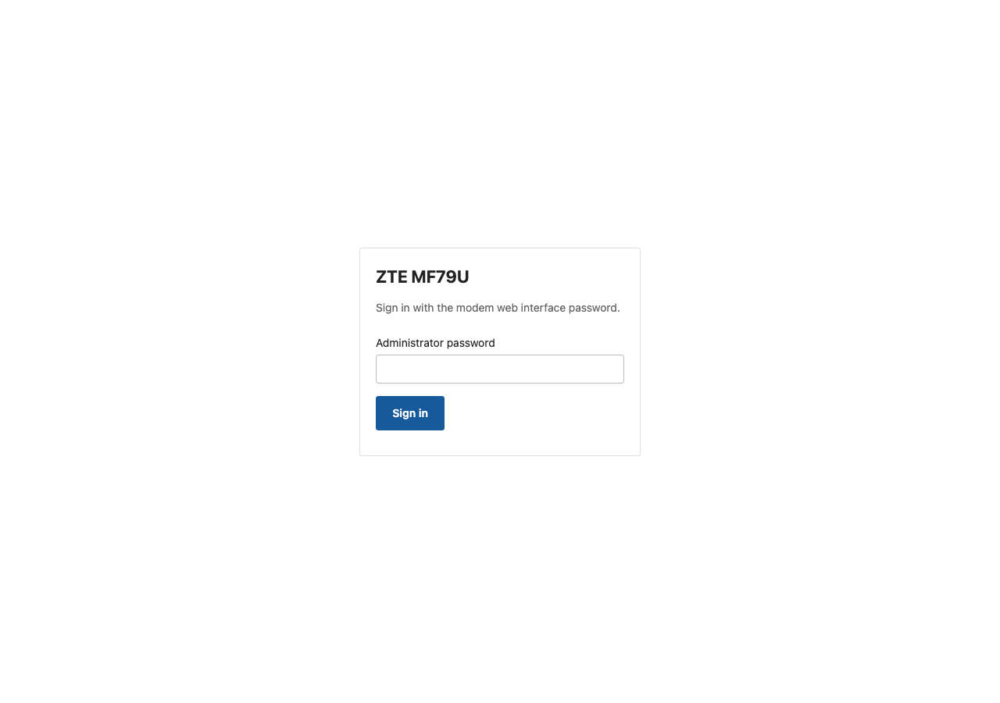 | 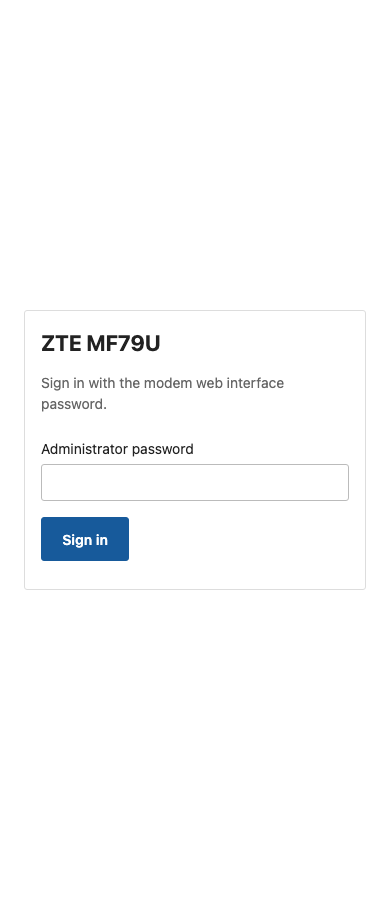 |

</details>

<details open>
<summary><strong>Status</strong></summary>

| Desktop · 1280 px | Mobile · 390 px |
| --- | --- |
|  | 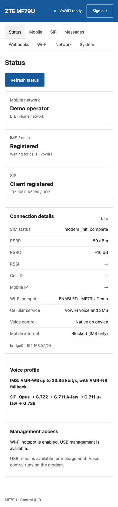 |

</details>

<details>
<summary><strong>Mobile</strong></summary>

| Desktop · 1280 px | Mobile · 390 px |
| --- | --- |
|  | 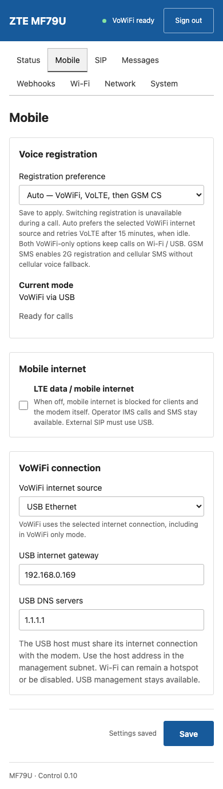 |

</details>

<details>
<summary><strong>SIP · built-in server</strong></summary>

| Desktop · 1280 px | Mobile · 390 px |
| --- | --- |
|  | 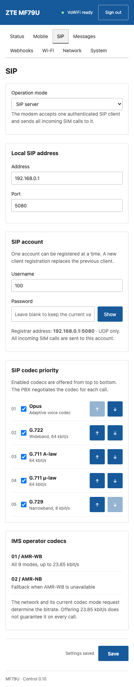 |

</details>

<details>
<summary><strong>SIP · PBX trunk</strong></summary>

| Desktop · 1280 px | Mobile · 390 px |
| --- | --- |
| 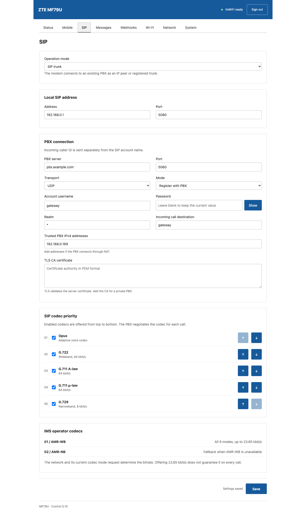 | 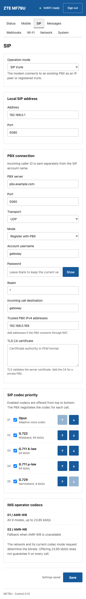 |

</details>

<details>
<summary><strong>Messages</strong></summary>

| Desktop · 1280 px | Mobile · 390 px |
| --- | --- |
| 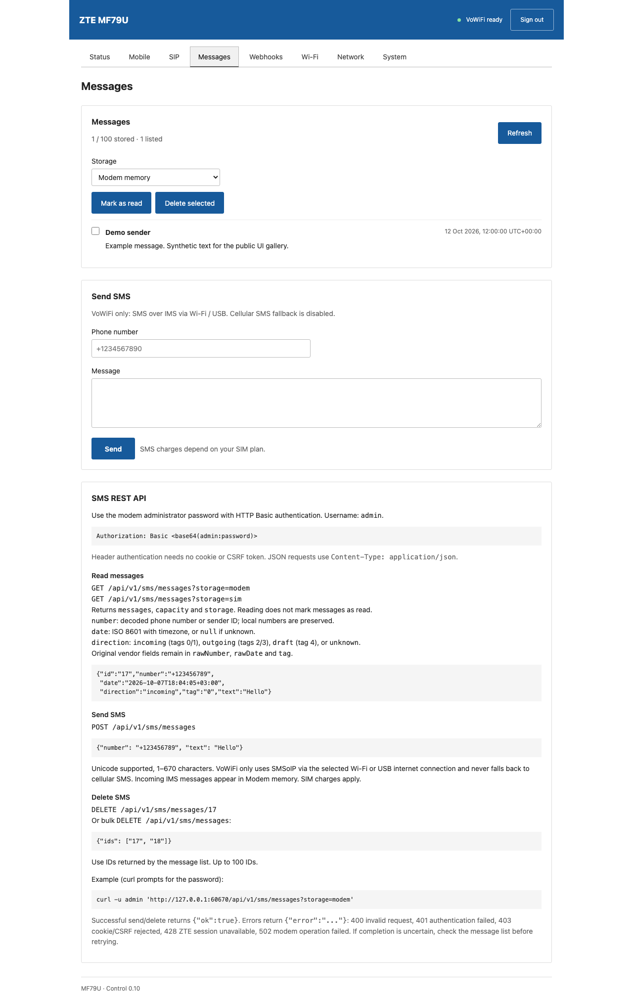 | 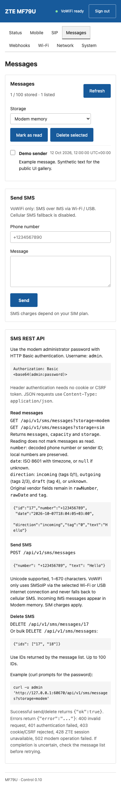 |

</details>

<details>
<summary><strong>Webhooks</strong></summary>

| Desktop · 1280 px | Mobile · 390 px |
| --- | --- |
| 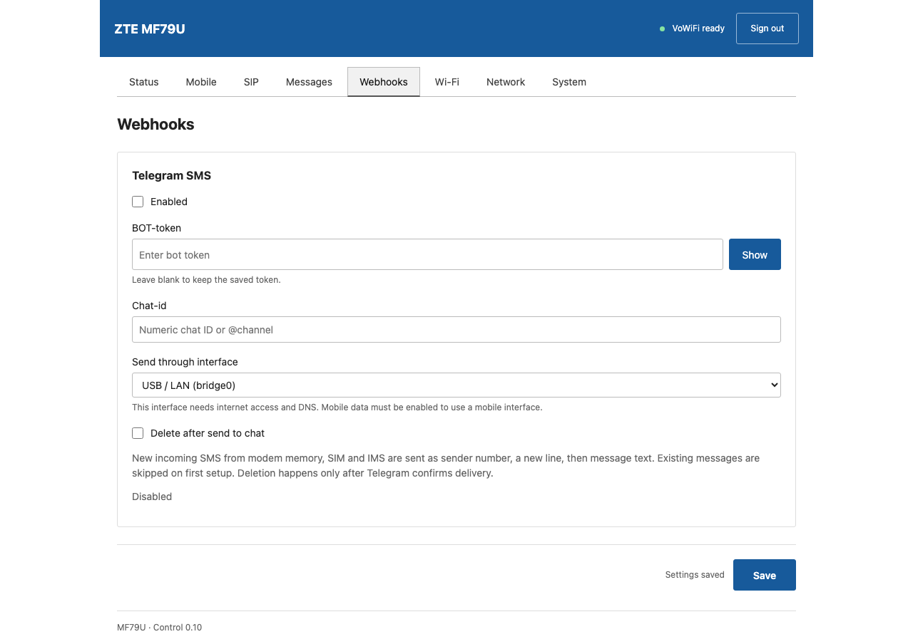 | 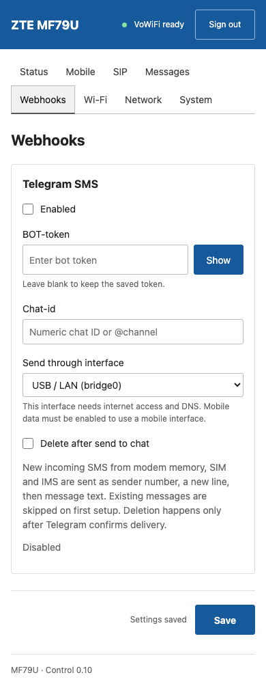 |

</details>

<details>
<summary><strong>Wi-Fi · Hotspot</strong></summary>

| Desktop · 1280 px | Mobile · 390 px |
| --- | --- |
| 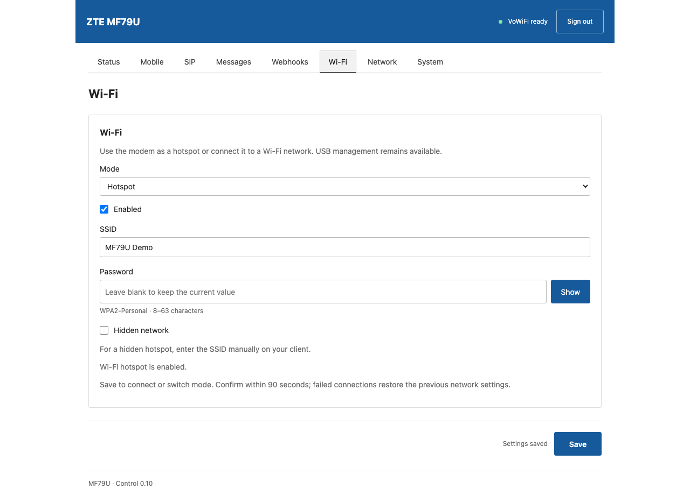 | 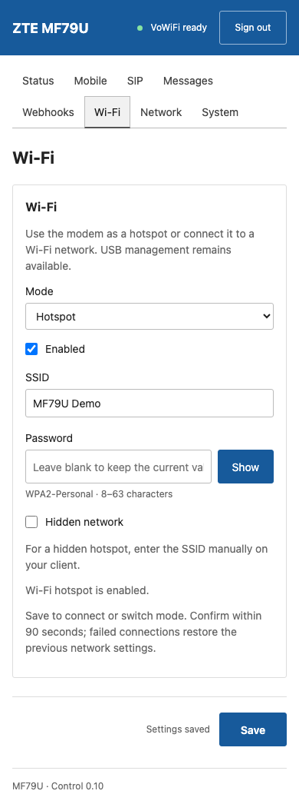 |

</details>

<details>
<summary><strong>Wi-Fi · Client and scan</strong></summary>

| Desktop · 1280 px | Mobile · 390 px |
| --- | --- |
|  | 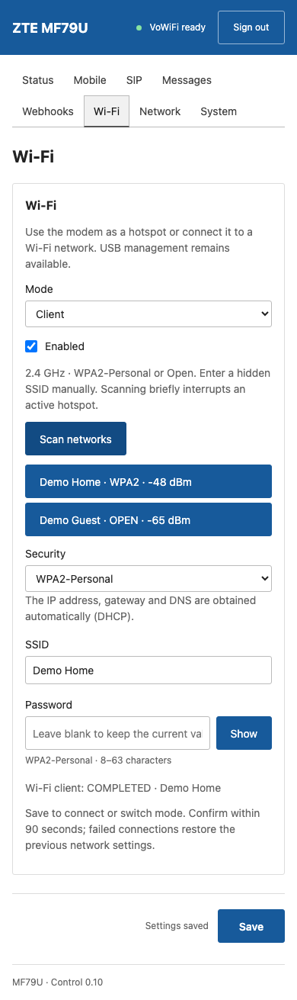 |

</details>

<details>
<summary><strong>Network</strong></summary>

| Desktop · 1280 px | Mobile · 390 px |
| --- | --- |
| 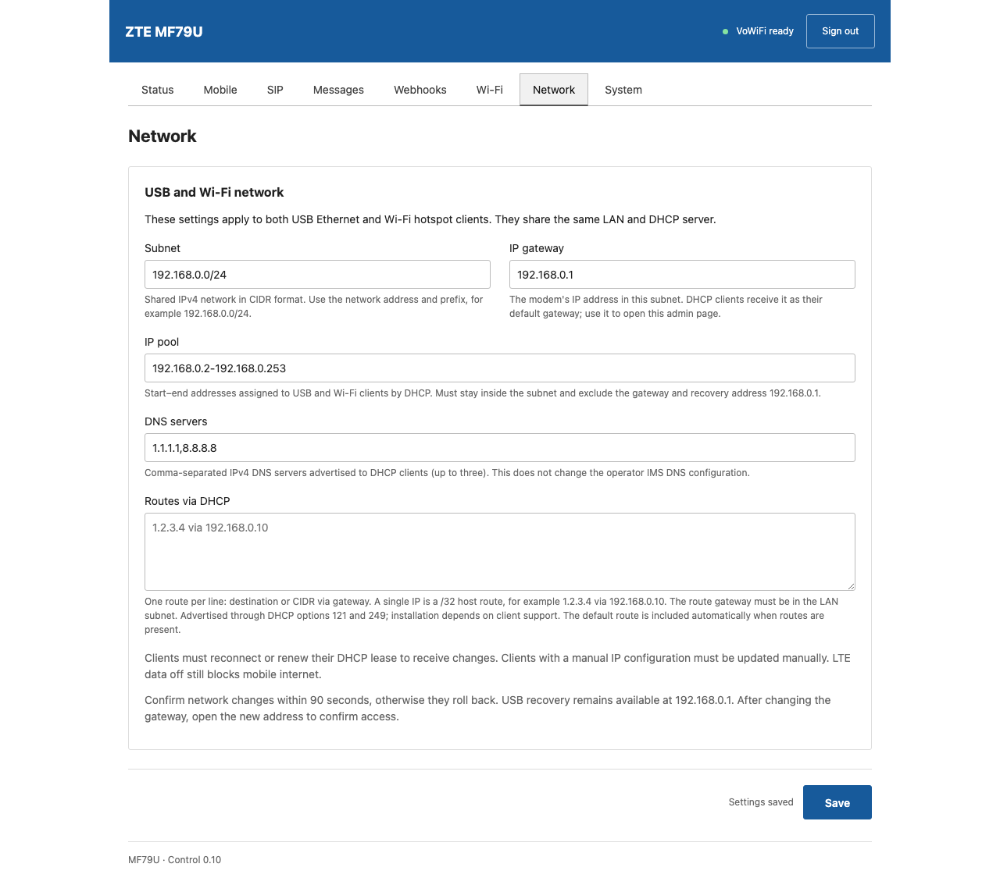 | 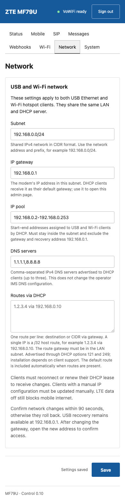 |

</details>

<details>
<summary><strong>System</strong></summary>

| Desktop · 1280 px | Mobile · 390 px |
| --- | --- |
| 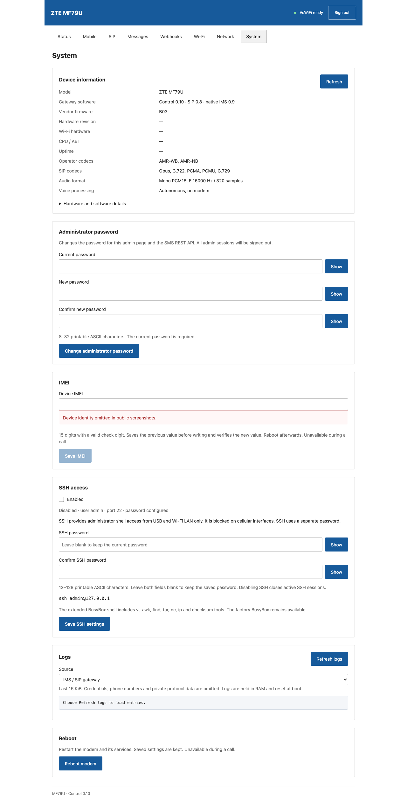 | 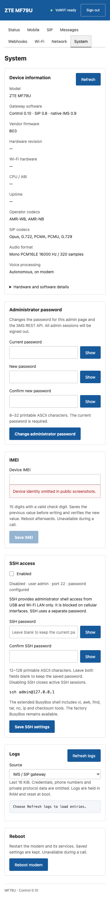 |

</details>

## Regenerate the gallery

Optional documentation tooling is pinned separately from firmware dependencies.
Node 24 and npm are required. From the repository root:

```sh
make docs-deps         # Locked Playwright and matching Chromium
make docs-assets       # Disposable loopback fixture; no modem access
make audit
```

To use an already installed browser, supply
`MF79U_BROWSER_EXECUTABLE=/absolute/path/to/chromium make docs-assets`.
`NODE_PATH` can select an existing Playwright installation. Otherwise the
repository's pinned local dependency is used.

The renderer serves the unmodified source UI and overrides fixture responses
with public demo values. It rejects external requests and unexpected writes;
the only POST is a simulated Wi-Fi scan. It checks ten authenticated views at
1280/390/320px for overflow, JavaScript errors and blank password fields. The
eight tabs plus trunk/Client variants produce twenty full-page screenshots;
two sign-in screenshots and the overview complete the gallery. A sanitized
validation report is written under ignored `reports/docs-assets.json`.
The public [provenance record](assets/provenance.json) contains browser versions,
source-asset hashes and screenshot hashes so readers can identify the capture.

SVG diagrams are editable repository assets, with accessible titles/descriptions.
They depict a simplified design and policy, not instrumented operator topology.
When the UI changes, rerun this target and review both desktop and mobile images
before committing. Device validation remains separate; see [TESTING](TESTING.md).
